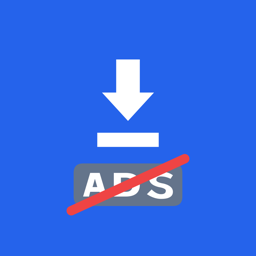
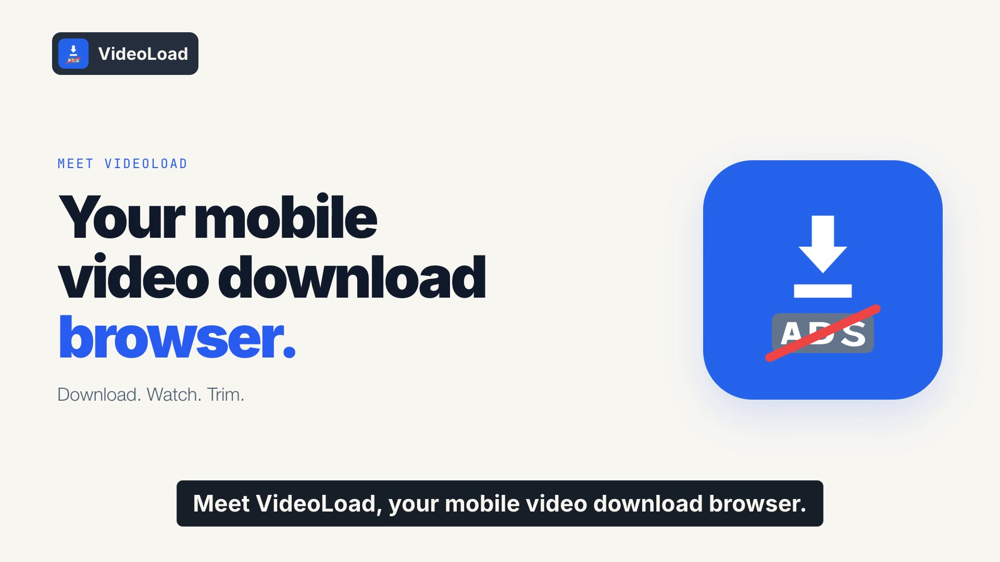
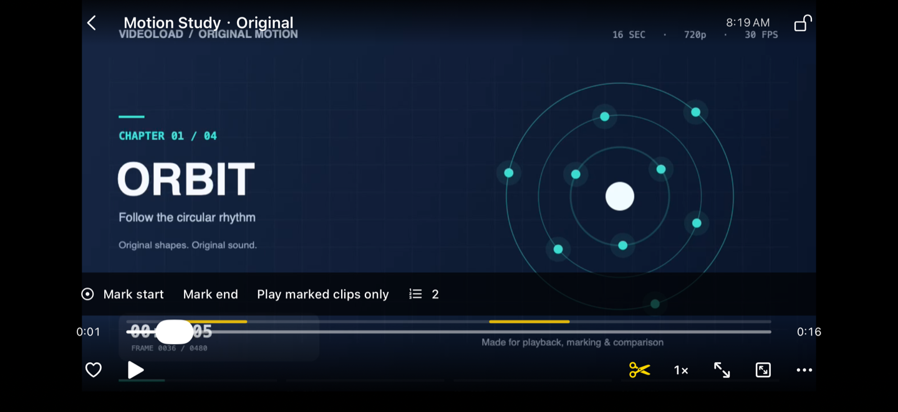
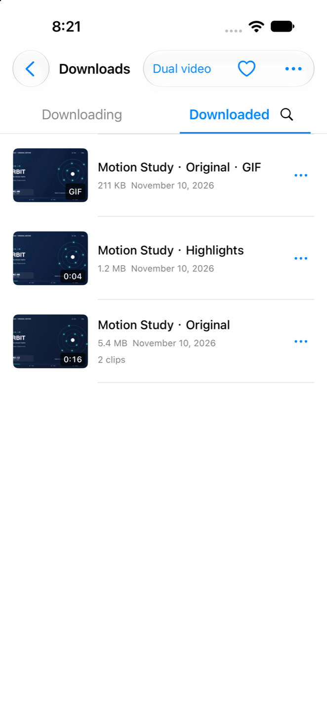
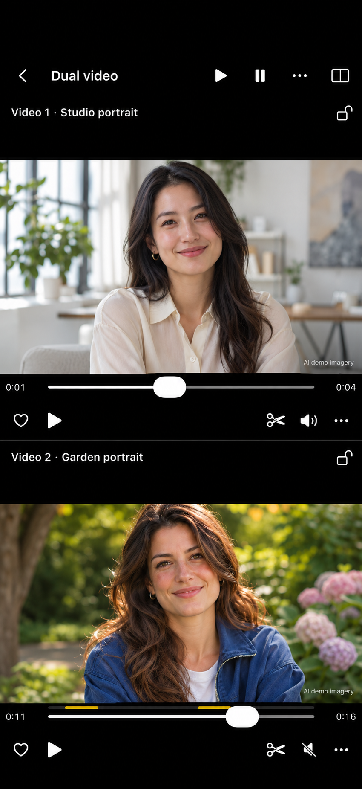

  

<h1 align="center">VideoLoad</h1>

<strong>A powerful mobile video download browser.</strong>

Download videos. Watch videos. Trim clips.

Free official website download · No app login · No in-app ads · Local browsing history · No activity-record collection

  <a href="https://videoload.pdos.work/">Official website</a> ·
  <a href="https://play.google.com/store/apps/details?id=com.fcj.videoload">Google Play</a> ·
  <a href="docs/downloads.md">All downloads</a> ·
  <a href="https://github.com/fcjnotbad-source/videoload-app/issues/new/choose">Feedback</a> ·
  <a href="README.zh-CN.md">简体中文</a>

The [official website](https://videoload.pdos.work/) supports all 14 app languages, with complete product, download and FAQ pages. Use the language menu to switch.

## Watch the product film

Download, watch and trim videos, with clip export and dual playback unlocked in the free official website edition.

[▶ Watch the product film](https://videoload.pdos.work/#film) · [Download the MP4](https://videoload.pdos.work/assets/promo/videoload-overview-en.mp4?v=privacy-2)

## Download videos. Watch videos. Trim clips.

VideoLoad is a **mobile video download browser** built around three core uses: **downloading videos, watching videos and trimming clips**. The official website edition is free, with compatible clip export and dual playback unlocked. Download supported videos you own or are allowed to save, play them on your phone and export clips as MP4 or GIF, without an app account.

**Your browsing history and activity records stay on your device.** We do not collect or upload these records to our servers. Browsing and downloads still contact your chosen websites and media hosts, which have their own privacy policies.

- **Download videos.** Save supported, authorized videos from the built-in browser and manage your downloads in one place.
- **Watch videos.** Play downloaded videos, adjust speed, mark moments and loop the parts you want.
- **Trim clips.** Select start and end points and export compatible clips as MP4 or GIF, processed on your device.
- **Double the fun.** Play two videos on one screen with independent controls for more ways to watch and compare.
- **Keep your library organized.** Search, rename and favorite your videos. The free official website edition also includes local video import.

## A look inside

  

<em>Mark the moments you want to watch again.</em>

<table>
  <tr>
    <th align="center">A library that stays with you</th>
    <th align="center">Two videos, twice the fun</th>
  </tr>
  <tr>
    <td align="center"></td>
    <td align="center"></td>
  </tr>
</table>

The player and library screenshots show the iPhone app, which is coming soon. The comparison preview uses AI-generated demo portraits with independently controlled video panes. Android appearance and some format limits differ.

## Get VideoLoad

| Platform | Official entry | Availability |
| --- | --- | --- |
| Android · Google Play | [Open Google Play](https://play.google.com/store/apps/details?id=com.fcj.videoload) | Availability depends on store rollout and region. |
| Android · direct edition | [Official APK download page](https://vdb.aivest.art/apps/jiange-kuaixia) | Separate Chinese-branded edition with its own updates and feature rules. |
| iPhone · App Store | Coming soon | App Store submission is in progress. The official link will be added here after release. |

[Download help and edition differences →](docs/downloads.md)

## Free official website edition

The official website edition includes browsing, video downloads, playback, clip marking, looping, compatible MP4/GIF clip export, local import and independently controlled dual playback, all unlocked for free.

Store editions may have different feature access and offer an optional one-time **VideoLoad Pro** purchase. Check your store for the applicable features and localized price; store purchases are platform-specific.

## Try your first marked clip

1. Install the app from an official entry above.
2. In the app's browser, open the [original demo media page](https://fcjnotbad-source.github.io/videoload-review-media/ios/review.html), then use the download button to save its MP4.
3. Open the downloaded video, mark a start and an end, then play your marked moments. Try looping them or comparing two videos in the free official website edition.

[Quick start →](docs/quick-start.md) · [Frequently asked questions →](docs/faq.md)

## Privacy and supported content

No app account is required. Browsing history and activity records stay on your device. We do not collect or upload these records to our servers. These local records include download records, playback progress and clip marks. VideoLoad adds no ads to its own interface. Websites you visit may show ads and use cookies, and browsing or downloading sends requests to those websites.

Only save content you own or are authorized to download. Website and format support varies. The app does not bypass DRM, paywalls or access controls. Two-video comparison uses independent controls and does not promise frame-accurate synchronization. On iOS, local HLS offline packages play in the app but cannot be exported to MP4/GIF, shared as files or saved to Photos. iOS controls background transfers; force-quitting stops them.

[Android privacy policy](https://fcjnotbad-source.github.io/videoload-review-media/privacy.html) · [iOS privacy policy](https://fcjnotbad-source.github.io/videoload-review-media/ios/privacy.html)

## Help shape the app

[Report a problem, suggest a feature or ask a question](https://github.com/fcjnotbad-source/videoload-app/issues/new/choose). English and Chinese are welcome. Please search [existing feedback](https://github.com/fcjnotbad-source/videoload-app/issues) first.

Include your app version, device and steps so we can understand the issue. Public feedback is visible to everyone; never post passwords, cookies, purchase receipts or private media. For matters that cannot be shared publicly, email [fcjnotbad@gmail.com](mailto:fcjnotbad@gmail.com).

If VideoLoad helps you, share this page with someone who could use it, leave an honest store review, or star this repository to help others discover it.

---

This is the official product showcase and feedback repository, with product documentation, images, the promotional film and the static [product website](website/README.md). VideoLoad branding and included product assets remain the property of their respective owner. See [asset notes](assets/README.md).
