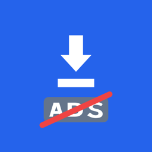
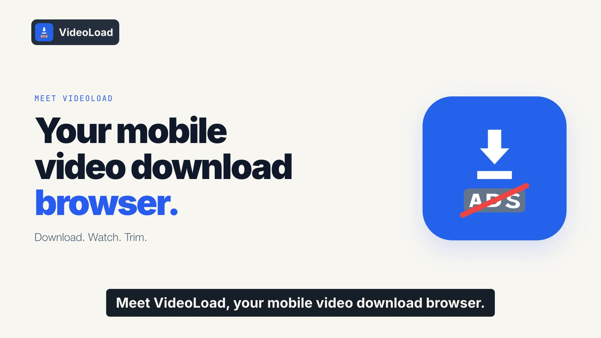
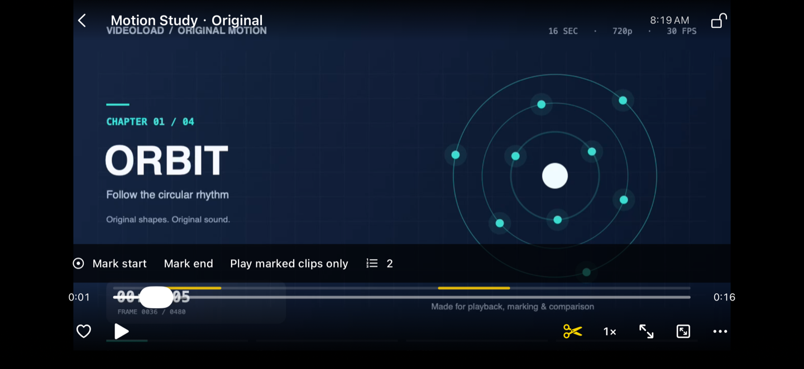
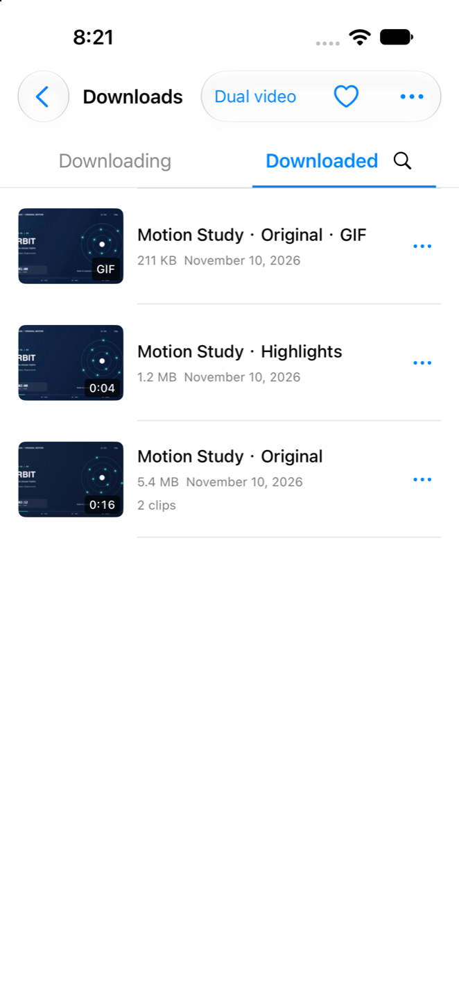
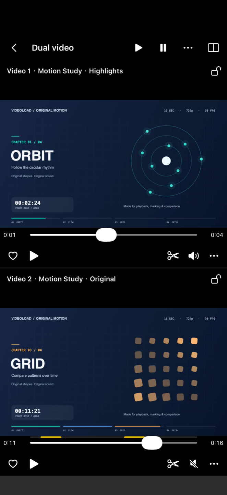

  

<h1 align="center">VideoLoad</h1>

<strong>功能强大的手机视频下载浏览器</strong>

下载视频 · 观看视频 · 视频截取

官网免费下载 · 无需登录 · 应用内无广告 · 视频无需上传给开发者 · 本机处理，保护隐私

  <a href="https://videoload.pdos.work/zh/">产品官网</a> ·
  <a href="https://play.google.com/store/apps/details?id=com.fcj.videoload">Google Play</a> ·
  <a href="docs/downloads.md#简体中文">下载入口</a> ·
  <a href="https://github.com/fcjnotbad-source/videoload-app/issues/new/choose">反馈建议</a> ·
  <a href="README.md">English</a>

[产品官网](https://videoload.pdos.work/zh/)现已覆盖应用内全部 14 种语言，产品介绍、下载说明和常见问答均已本地化，可通过语言菜单切换。

## 观看产品宣传片

英文解说、英文字幕，集中展示下载视频、观看视频、视频截取、免登录与本机隐私处理，以及官网免费直装版双屏播放的乐趣。

[▶ 观看产品宣传片](https://videoload.pdos.work/zh/#film) · [下载 MP4 视频](https://videoload.pdos.work/assets/promo/videoload-overview-en.mp4)

## 手机视频下载浏览器：下载视频、观看视频、视频截取

VideoLoad 是一款**功能强大的手机视频下载浏览器**，围绕**下载视频、观看视频、视频截取**三大用途设计。官网直装版免费，片段导出和双屏播放已解锁。无需登录，保存自己拥有或已获授权下载的受支持视频，在手机上直接观看，再将兼容来源的片段导出为 MP4 或 GIF。

**视频在本机播放和处理，无需上传给开发者，保护隐私。** 浏览网页与下载仍会连接你选择的网站和媒体服务器，相关网站有自己的隐私政策。

- **下载视频。** 通过内置浏览器保存受支持的授权视频，下载任务集中管理。
- **观看视频。** 直接播放已下载的视频，调整倍速、标注片段、循环回看。
- **视频截取。** 标记起点和终点，将兼容来源的片段导出为 MP4 或 GIF，全程在设备上处理。
- **双屏播放，多一份乐趣。** 两个视频同屏播放，各自独立控制，边看边对照。
- **更多实用功能。** 搜索、重命名、收藏视频；官网免费直装版还可导入本地视频。

## 看看实际界面

  

<em>标记值得回看的片段，下次直接看重点。</em>

<table>
  <tr>
    <th align="center">自己的视频，集中整理</th>
    <th align="center">双屏播放，多一点乐趣</th>
  </tr>
  <tr>
    <td align="center"></td>
    <td align="center"></td>
  </tr>
</table>

以上为即将上线的 iOS 应用真实截图，使用开发者自制的演示素材。Android 界面及部分格式限制有所不同；播放器中的几何动画是示例视频内容。

## 官方下载

| 平台 | 入口 | 状态 |
| --- | --- | --- |
| Android · Google Play | [前往 Google Play](https://play.google.com/store/apps/details?id=com.fcj.videoload) | 是否可安装以所在地区和商店发布状态为准。 |
| Android · 官网直装版 | [官方下载页](https://vdb.aivest.art/apps/jiange-kuaixia) | 独立中文品牌版本，更新渠道与功能规则不同。 |
| iPhone · App Store | 即将上线 | 正在提交 App Store，上架后补充官方链接。 |

[查看安装说明与版本区别 →](docs/downloads.md#简体中文)

## 官网直装版免费，实用功能直接用

官网免费直装版已解锁网页浏览、视频下载与播放、片段标注与循环、兼容来源的 MP4/GIF 导出、本地导入和独立双屏播放。

商店版的功能开放方式可能不同，可选 **VideoLoad Pro** 买断内购。具体功能与当地价格以对应商店为准，商店购买权益按平台独立。

## 第一次使用

1. 从上方官方入口安装应用。
2. 在应用内浏览器打开[原创演示素材页](https://fcjnotbad-source.github.io/videoload-review-media/ios/review-zh.html)，通过下载按钮保存其中的 MP4。
3. 打开下载的视频，标记起点和终点，再选择只播标注。还可以尝试循环回看，或使用官网免费直装版体验双屏对照。

[快速上手 →](docs/quick-start.md#简体中文) · [常见问题 →](docs/faq.md#简体中文)

## 隐私与使用范围

无需应用账号，视频处理和片段标注保留在本机，无需向开发者上传媒体。应用自身界面不投放广告；访问的网站可能展示广告或使用 Cookie，浏览和下载会向相关网站发送网络请求。

请仅保存自己拥有或已获授权下载的内容。不同网站与格式的兼容性有所差异，应用不会绕过 DRM、付费墙或访问限制。双屏为独立控制，不保证逐帧同步。iOS 的本地 HLS 离线包可在应用内播放，但不能导出为 MP4/GIF、分享文件或保存到系统相册。iOS 后台传输由系统调度，强制退出会停止下载。

[Android 隐私政策](https://fcjnotbad-source.github.io/videoload-review-media/privacy.html) · [iOS 隐私政策](https://fcjnotbad-source.github.io/videoload-review-media/ios/privacy-zh.html)

## 一起让它更好用

[报告问题、提出建议或咨询用法](https://github.com/fcjnotbad-source/videoload-app/issues/new/choose)，中文、英文都可以。提交前可先[搜索已有反馈](https://github.com/fcjnotbad-source/videoload-app/issues)。

请附上应用版本、设备型号和操作步骤。公开反馈所有人可见，请勿上传密码、Cookie、购买凭据或私人视频；不便公开的事项可邮件联系 [fcjnotbad@gmail.com](mailto:fcjnotbad@gmail.com)。

如果觉得好用，欢迎分享本页、在商店留下真实评价，或点一个 Star，让更多人发现 VideoLoad。

---

这是官方产品展示与反馈仓库，包含产品介绍、图片、宣传片与[静态官网](website/README.md)。VideoLoad 品牌及产品素材的权利归各自所有者所有，详见[素材说明](assets/README.md)。
